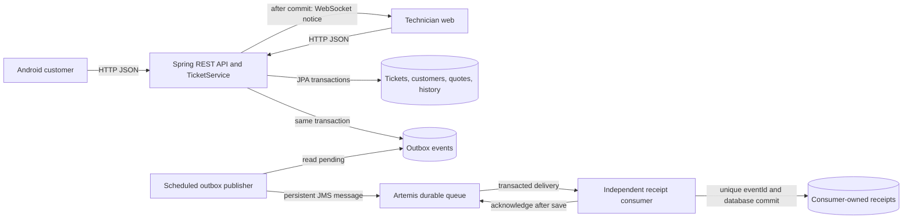

# Repair Desk: technical report draft

Assessment 3 MVP. Group/member details and final submission links must be completed by the submitting team. Final version identifier: `mvp-assessment3`.

## 1. Project overview and starting point

Customers book and track device repairs using Android; technicians diagnose devices, issue quotes and progress repairs using the web client. Booking/diagnosis and quote-decision/repair are connected workflows: a customer booking creates technician work; a customer's quote decision changes whether repair can begin. READY status informs the customer that collection is possible.

The selected starting point is kiwilu's Assessment 2 `repair-tickets`, imported at `328aeea` (`a2-baseline`). Retained components include REST ticket booking/status/history, persistence, validation and the basic three-page web client. Assessment 3 adds quotes and customer decisions, Android and notifications, WebSocket updates/recovery, ticket concurrency protection, and advanced broker integration.

## 2. Architecture and communication

Controllers own HTTP/validation concerns, TicketService owns workflow rules and transaction boundaries, and repositories own data access. Clients never access database tables directly. The consumer owns a separate H2 receipt database and does not modify tickets. The broker and consumer run in separate JVM processes from the API.

### API and event contracts

| Operation | Result |
| --- | --- |
| POST /api/tickets | Validated booking, 201 and Location |
| GET /api/tickets?status=&email= | Filtered list, 200 |
| GET /api/tickets/{id} | Current ticket, version, quote and history, 200/404 |
| PATCH /api/tickets/{id}/status | Valid transition, 200; invalid transition or concurrent update, 409 |
| POST /api/tickets/{id}/quote | Quote during diagnosis, 201; conflicting state, 409 |
| POST /api/tickets/{id}/quote/decision | Customer decision, 200; supplied-email mismatch, 403; no pending quote, 409 |
| DELETE /api/tickets/{id} | Cancel before diagnosis, 204; otherwise 409 |
| GET /api/integration/status | Pending and published outbox counts |

Errors use timestamp, status, error, message, path and fieldErrors. Customer email selection is not authentication; the 403 check prevents mismatched submitted identities but cannot establish the caller's identity.

Domain event fields: eventId (stable UUID), change, ticketId, customerEmail, status, quoteStatus and updatedAt. A WebSocket subscriber sends `{"type":"subscribe"}`, waits for `subscribed`, then fetches its REST snapshot. `ticketChanged` notices trigger another snapshot; the database remains authoritative. Version guards and request generations prevent stale asynchronous loads from regressing displayed state.

### Advanced path B and design decision

The outbox row is inserted synchronously in the same transaction as the ticket. The publisher sends committed rows to a durable queue, commits JMS and marks delivery. If the broker is unavailable, REST operations still succeed and the outbox remains pending for retry. A crash after send but before recording delivery may repeat an event.

The consumer inserts a receipt keyed by eventId, commits its database transaction, then acknowledges the JMS delivery. A crash in between causes redelivery. A repeated key is skipped and acknowledged; other processing failures roll back JMS. The resulting guarantee is at-least-once delivery with an idempotent saved effect, not exactly-once transport. Keeping the consumer database open across deliveries avoids repeated AUTO_SERVER startup overhead while preserving independent inspection.

This choice preserves the existing ticket service and follows Week 10's durable queue, acknowledgement and duplicate-effect experiments. It demonstrates an asynchronous business audit result without introducing a second ticket-data owner.

Android notifications are a separate mobile capability: API polling identifies relevant changes and posts a local notification. Background jobs can be deferred by Android. Denied notification permission leaves booking and quote decisions available.

## 3. Implementation status

| Function | Status |
| --- | --- |
| Booking, diagnosis, quote decline/revision/approval, repair progression | Implemented; backend and HTTP workflow checks executed |
| Layered persistence, validation and structured errors | Implemented and tested |
| WebSocket subscription, reconnect snapshots and stale-response handling | Implemented; network/integration and browser-script checks executed; visual walkthrough remains |
| Broker, outbox retry, independent consumer and idempotent receipts | Implemented; persistent queue restart and real consumer crash/redelivery checked |
| Native Android client and notification capability | APK builds; lint completes with no errors; device acceptance checks remain |
| Repeatable response-time and failure checks | Implemented; actual results in VERIFICATION.md and evidence files |
| Root startup guide and demonstration checklist | Included |
| Final team report, individual reports and recording | Requires team completion/export and actual device evidence |

## 4. Testing and results

See [VERIFICATION.md](VERIFICATION.md), [evidence/system-checks.json](evidence/system-checks.json), [evidence/response-time.json](evidence/response-time.json), the Java test suites, and scripts/web-tests.mjs. These distinguish executed automated checks from pending visual/device checks. Test scripts retain actual component logs under ignored test-results directories.

Response-time requirement: p95 ticket-detail HTTP operation under 500 ms under the documented local test conditions. The target leaves a substantial margin for local network/UI work while keeping a common read responsive. Measurement includes response transfer and JSON parsing, with 101 tickets, 10 warm-ups, 100 measured requests and concurrency 1. It does not establish mobile end-to-end latency, load capacity or a production service-level guarantee.

Failure verification includes unavailable broker with committed pending events, broker restart with queued messages, consumer crash after database save before acknowledgement, repeated eventId, API stop/restart, and WebSocket reconnection. State assertions cover ticket status, quote and history retention.

## 5. Team contributions and checkpoints

Complete this section from actual member work and evidence; do not assign a contribution merely because a commit uses one person's account.

| Member | Technical responsibility | Files/commits/tests explained by that member |
| --- | --- | --- |
| To complete | To complete | To complete |

Checkpoint evidence should identify a demonstrated Android-to-API workflow and a later live-update or broker integration, using actual test/recording dates and commit identifiers. Record shared or pair work accurately. Each member must be able to explain the complete workflow and their own changes.

## 6. Limitations and improvements

- No authenticated users or role enforcement; the selected customer email can be supplied by any caller.
- H2 and one API/publisher instance suit a local demonstration. Multiple publishers would require outbox claiming/locking.
- The consumer persists audit receipts; it does not deliver email, SMS or broker-driven Android push notifications.
- Android notification latency is best effort. Device UI, permissions and notification navigation need recorded manual checks.
- Receipts and sent outbox rows have no retention policy. Invalid messages have no operator inspection/recovery interface.
- HTTP and the broker are local development configurations without production TLS or broker authentication.
- Browser tests exercise scripts with a DOM test double; they are not visual browser automation.

Prioritise actual device acceptance and submission evidence, then authentication, retention/operational tooling and deployment hardening as future improvements.

Implementation references: supplied Android UI lab (Java/XML, Intents and lifecycle), supplied Week 9 starter (background network executor), supplied Week 6 REST lab (controller/service separation), and supplied Week 10 Messaging Lab (durable queue, post-save acknowledgement, idempotency and reconnect snapshot). Additional API references: [Artemis embedding](https://artemis.apache.org/components/artemis/documentation/latest/embedding-artemis.html), [JMS usage](https://artemis.apache.org/components/artemis/documentation/latest/using-jms.html), [broker disk reserve](https://artemis.apache.org/components/artemis/documentation/latest/paging.html), and [Android notification permissions](https://developer.android.com/develop/ui/views/notifications/notification-permission).
